# Code Judge — Development Plan

Rule for the whole project: **the app must work at the end of every phase.** Never leave a phase half done and jump to the next one.

Current state of the repo: **phases 0 and 1 are done, and phase 2's backend is
done.** Sign up, confirm the address, sign in, stay signed in, and change the
password all work. The problems API is finished and seeded with 12 questions;
its two pages on the React side are what is left of phase 2.

```
Code-Judge/
├── backend/            express + mongoose, auth finished
├── frontend/           vite + react, auth screens finished
├── docs/               these documents
├── docker-compose.yml  MongoDB now, Redis from phase 6
└── idea.md
```

MongoDB runs in Docker, as a **one-member replica set** rather than standalone,
because that is the only way MongoDB offers transactions. From the repo root:

```
docker compose up -d           # start MongoDB
docker compose up mongo-init   # start its replica set, first time only
docker compose down            # stop it, keep the data
```

`mongo-init` runs once and exits; running it again says the replica set is
already going. One member gives no redundancy, which is fine for a development
database — it is there for transactions, not for failover.

---

## Target shape



> Source: [diagrams/architecture.mmd](diagrams/architecture.mmd)

Three processes run: **api**, **worker**, **web**. Plus MongoDB and Redis.

What happens when someone presses Submit:



> Source: [diagrams/submission-flow.mmd](diagrams/submission-flow.mmd)

---

## Folder plan

```
backend/src/
├── config/        env, db, redis, logger, mailer
├── models/        mongoose schemas
├── routes/        route files only, no logic
├── controllers/
│   ├── auth/
│   │   ├── index.js    one handler per route
│   │   └── helpers.js  what those handlers share
│   ├── problems/       same two files, same rule
├── middlewares/   auth, roles, validation, rate limit, errors
├── validators/    zod schemas, plus common.js for the shared pieces
├── seed/          npm run seed: the starter problems
├── queue/         bullmq queue + job names
├── sockets/       websocket setup
└── utils/         tokens, cookies, durations, access tokens, slugs, audit

worker/src/
├── index.js       queue consumer
├── runners/       java.js, python.js, cpp.js
├── docker/        container run + limits
├── compare.js     output comparison
└── images/        one Dockerfile per language

frontend/src/
├── api/           axios client, token refresh
├── auth/          auth context, guards
├── pages/         Problems, Problem, Login, Register, Profile, Submissions
├── components/    Editor, ResultPanel, ProblemList, Nav
└── hooks/
```

---

## Phase 0 — Base setup (1–2 days)

**Do**

> There is no `services/` layer. A controller reads the request, does the work
> and sends the response. Anything a middleware also needs — signing and
> checking access tokens — lives in `utils/`, because a middleware importing
> from a controller would have the dependencies pointing the wrong way.
>
> A controller with more than a handful of routes becomes a folder:
> `index.js` holds one handler per route and is what `routes/` imports,
> `helpers.js` holds what those handlers share. Nothing in `helpers.js` touches
> `res` — it does work and returns a value, and the handler decides what to
> send. Phase 2's problems and submissions get the same shape.

- Add to backend: `zod`, `bcrypt`, `jsonwebtoken`, `cookie-parser`, `helmet`, `pino`, `ioredis`, `bullmq`, `nodemailer`.
- Add to frontend: `react-router-dom`, `axios`, `@monaco-editor/react`.
- Finish `config/env.js` so the app crashes at startup if an env var is missing.
- One error middleware and one error shape.
- `GET /api/health` returns `{ ok: true }` and the Mongo connection state.

**Done when:** React calls `/api/health` through the Vite proxy and shows `ok`.

---

## Phase 1 — Authentication (4–6 days) — **done**

This is the biggest non-judge piece. Build it from [04-authentication.md](04-authentication.md).
The by-hand checks are in [06-phase1-checklist.md](06-phase1-checklist.md).

Login is only **email + password**. No second step, no Google, no GitHub, no authenticator app. Email is used for two links only: verify the address, and reset a forgotten password.

**Do**

1. `users`, `sessions`, and `authTokens` collections.
2. Register → send the verification email. In development, print the link to the console or use Mailhog.
3. Login → access token in memory, refresh token in an httpOnly cookie.
4. Refresh with rotation and reuse detection.
5. Logout, logout-all, password change, password reset.
6. `requireAuth` and `requireRole` middleware. `requireAuth` does the whole check: signature, account status, `emailVerified`, and `tokenVersion`.
7. React: auth context, axios interceptor that refreshes on `401`, protected routes.

Two things landed differently from the first draft, both written up in
[04-authentication.md](04-authentication.md):

- Access tokens are signed **HS256 with one secret**, not RS256 with a key pair. Only the API reads them.
- **No rate limits and no account lockout.** Rate limits need Redis, which arrives in phase 6. bcrypt is the only thing slowing a password guesser down until then.

**Done when:** you log in, wait for the access token to expire, keep clicking, and nothing breaks — the token refreshes by itself. Replaying an old refresh token logs the real user out too.

---

## Phase 2 — Problems and test cases (3–4 days) — **backend done**

Build it from [08-problems-api.md](08-problems-api.md). The by-hand checks are in
[09-phase2-checklist.md](09-phase2-checklist.md).

**Done**

1. `problems` and `testCases` collections with the fields from [03-db-design.md](03-db-design.md).
2. Public: `GET /api/problems` (paged, filtered, searched, sorted), `GET /api/problems/:slug`.
3. Setter/admin: `POST`, `PATCH`, `DELETE /api/problems/:id`, and four test case routes.
4. Public reads strip hidden test cases and drafts.
5. `npm run seed` makes an `admin` and a `setter` account if they are missing, then writes 12 problems and 58 test cases. Safe to run twice, and it refuses to make accounts when `NODE_ENV=production`.

**Still to do**

- React: problem list page and problem detail page.

Five things landed differently from the first draft, all written up in
[08-problems-api.md](08-problems-api.md):

- **A new problem is always a draft.** `isPublished` is stripped from the create
  body, so going live is always a PATCH — which is where the checks live.
- **Publishing needs at least one test case and at least one sample**, and a
  published problem cannot lose its last one of either. Phase 3's Run button has
  nothing to run otherwise.
- **A published problem cannot be deleted.** Unpublish it first.
- **A draft is a 404, not a 403**, to everyone but its author and an admin. A 403
  would admit that it exists. Same reason a visitor asking for `?status=DRAFT` is
  quietly handed published problems instead of an error.
- **A new `optionalAuth` middleware**, so one list route can work signed out and
  show more when signed in. Phase 9 needs it again to mark solved problems.

A note on testing: the checklist in
[09-phase2-checklist.md](09-phase2-checklist.md) covers the hidden-case rule by
hand, in step 3 and step 7. That is a checklist, not the automated test this
phase originally asked for. When a test runner does arrive, that rule is the
first thing to move into it.

**Done when:** you can browse problems and open one, and no API response ever contains a hidden test case.

---

## Phase 3 — Editor page (2–3 days)

**Do**

- Monaco editor, language dropdown, starter code loading, reset button.
- Two-column layout: question on the left, editor on the right, result box below.
- **Run** and **Submit** buttons that do nothing yet.

**Done when:** the page looks like a real judge, even though nothing runs.

---

## Phase 4 — First judge, no Docker (3–4 days)

Goal: get the pipeline correct first. Safety comes in Phase 5.

**Do**

- `POST /api/submissions` saves a submission with `QUEUED`.
- A local runner writes the code to a temp folder, runs one command with `child_process.spawn` and a timeout, feeds stdin, and reads stdout. For Java that one command is `java Main.java`, which compiles and runs in one go (JDK 11 or newer).
- Compare output, set the verdict, save time and memory.
- `GET /api/submissions/:id` so the UI can poll every second.

**Done when:** a `Main.java` that prints `10` gets `ACCEPTED`, a wrong answer gets `WRONG_ANSWER`, and code that does not compile gets `COMPILATION_ERROR`.

> Warning to keep in the code as a comment: this runner is for local development only. It runs code on your own machine with no wall around it.

---

## Phase 5 — Docker sandbox (4–6 days)

**Do**

- `Dockerfile.java` with a non-root user and only the JDK inside.
- Run each submission with: `--network=none`, `--memory`, `--memory-swap` equal to memory (no swap), `--cpus`, `--pids-limit`, `--read-only`, a small `tmpfs` for the work folder, `--cap-drop=ALL`, `--user 1000:1000`, and `--rm`.
- A wall-clock timer in the worker that kills the container if Docker does not.
- Map exit codes to verdicts: 20 → compilation error (the entrypoint script uses this one), 124 → time limit, 137 → memory limit, other non-zero → runtime error.
- Cut stdout/stderr to a size limit.

**Done when:** an endless loop returns `TIME_LIMIT_EXCEEDED`, a big array returns `MEMORY_LIMIT_EXCEEDED`, opening a socket fails because there is no network, and `docker ps -a` is empty after the run.

---

## Phase 6 — Redis queue and a separate worker (3–4 days)

**Do**

- BullMQ queue `submissions`. The API only adds a job and returns `202`.
- New `worker/` process with its own `package.json` and its own Docker access.
- Job flow: `QUEUED → RUNNING → verdict`, written to MongoDB by the worker.
- Retry only on `SYSTEM_ERROR`, max 2 times. A job that already has a verdict is skipped.
- Limit per user: max 5 waiting submissions, 1 submission every 3 seconds.

**Done when:** you stop the worker, submit 20 times, start the worker again, and all 20 get judged in order. The API stays fast the whole time.

---

## Phase 7 — Live status with WebSockets (2 days)

**Do**

- Worker publishes status changes to a Redis channel.
- API subscribes and pushes to the right user's socket. Auth on the socket with the access token.
- React shows `Queued → Running → Accepted` without refreshing. Keep polling as a fallback.

**Done when:** the status changes by itself in front of you.

---

## Phase 8 — More languages (3–4 days)

**Do**

- Add Python and C++ images.
- A `runners` map: language → image, file name, and the one command to run.
   - Java: `java Main.java`
   - Python: `python3 main.py`
   - C++: `g++ -O2 -o main main.cpp && ./main`
- Each image has a small entrypoint script. If the compile part fails it prints the compiler message and exits with code `20`, which the worker turns into `COMPILATION_ERROR`. The worker still sees only one step.
- `supportedLanguages` on the problem controls the dropdown, and the server checks it too.

**Done when:** the same problem passes in three languages.

---

## Phase 9 — History and profiles (3 days)

**Do**

- `GET /api/submissions/me` with paging and filters, index `{ userId: 1, createdAt: -1 }`.
- Update the user's counters when a verdict is written. First accept for a problem also adds it to the solved list.
- Profile page with counts and language usage.

**Done when:** solving a new problem makes the profile number go up by exactly one, even if you solve it twice.

---

## Phase 10 — Admin, contests, leaderboard (1–2 weeks, optional)

**Do**

- Admin pages for problems, test cases, and users.
- `contests` and `contestParticipants` collections.
- Contest page, scoring with penalty, live ranking.

---

## Phase 11 — Polish and deploy (4–5 days)

**Do**

- `docker-compose.yml` for mongo, redis, api, worker, web.
- Indexes created on start, or by a migration script.
- Helmet, CORS allow-list, rate limits, Zod on every route.
- Logs with request ids, `/healthz` and `/readyz`.
- README with screenshots, an architecture picture, and an honest section on sandbox limits.
- Deploy: web on Vercel, api and worker on a small VM that has Docker, Mongo Atlas, Redis (Upstash or on the same VM).

**Done when:** a stranger can clone the repo, copy `.env.example`, run `docker compose up`, and submit code.

---

## Suggested order and time

| Week | Phases | Result                            |
| ---- | ------ | --------------------------------- |
| 1    | 0, 1   | Login works                       |
| 2    | 2, 3   | Problems and editor               |
| 3    | 4      | Code runs and gets a verdict      |
| 4    | 5      | Docker sandbox                    |
| 5    | 6, 7   | Queue, worker, live status        |
| 6    | 8, 9   | Three languages, history, profile |
| 7    | 11     | Deploy and README                 |
| 8+   | 10     | Contests and admin                |

**Stop line for the resume:** after week 7 you already have a strong project. Weeks 8+ are extra.

---

## Tests worth writing (do not skip these three)

1. A public problem response never contains a hidden test case.
2. A replayed old refresh token kills the whole session family.
3. An endless loop and a memory bomb both end with the right verdict and no container left behind.

---

## Risks and what to do

| Risk               | What happens                         | What to do                                                                                                                                    |
| ------------------ | ------------------------------------ | --------------------------------------------------------------------------------------------------------------------------------------------- |
| Sandbox escape     | Someone runs commands on your server | No network, non-root, drop capabilities, read-only disk. Write down the limits. Never run the worker as root on the same box as the database. |
| Queue never drains | Submissions stay `QUEUED` forever    | Job timeout, dead-letter queue, alert when queue depth grows.                                                                                 |
| Big output         | Database fills up                    | Cut output at a fixed size, both in the worker and before saving.                                                                             |
| Docker cold start  | First run is slow                    | Pull images at worker startup and keep a warm pool later.                                                                                     |
| Scope creep        | Contests before the judge works      | Follow the phase order. V1 first.                                                                                                             |
