# Code Judge — Database Design (MongoDB)

No model code here — only fields, types, examples, indexes, and how the collections connect.

**Types used below**

| Name | Meaning |
|------|---------|
| `ObjectId` | Mongo id, or a link to another document |
| `String`, `Number`, `Boolean`, `Date` | normal types |
| `Enum[...]` | a string, but only from the listed values |
| `String[]` | array of strings |
| `Object` | an embedded object |
| `Object[]` | array of embedded objects |

**Rules used everywhere**

- Every collection has `createdAt` and `updatedAt` (`Date`, set by Mongo timestamps).
- Ids are `ObjectId` unless written otherwise.
- Money-like or count-like fields never go below 0.
- Nothing secret (password hash, token hash) is ever sent to the browser.

---

## V1 collections (build these four first)

`users` · `problems` · `testCases` · `submissions`

Auth needs two more small ones: `sessions` and `authTokens`.

## V2 / V3 collections

`submissionResults` · `tags` · `contests` · `contestParticipants` · `auditLogs`

---

# 1. `users`

Who the person is, their role, and their score counters.

| Field | Type | Required | Notes |
|-------|------|----------|-------|
| `_id` | ObjectId | yes | |
| `username` | String | yes | 3–20 chars, letters/numbers/underscore, unique, stored lowercase |
| `displayName` | String | no | free text shown on the profile |
| `email` | String | yes | unique, stored lowercase and trimmed |
| `emailVerified` | Boolean | yes | default `false` |
| `passwordHash` | String | yes | bcrypt hash (cost 12). The real password is never stored. Never returned by the API. |
| `passwordUpdatedAt` | Date | no | used to reject old tokens |
| `role` | Enum[`USER`,`SETTER`,`ADMIN`] | yes | default `USER` |
| `status` | Enum[`ACTIVE`,`BANNED`,`DELETED`] | yes | default `ACTIVE` |
| `tokenVersion` | Number | yes | default `0`. Add 1 to kill every token at once. |
| `avatarUrl` | String | no | |
| `bio` | String | no | max 300 chars |
| `stats` | Object | yes | counters kept up to date by the judge |
| `stats.solvedTotal` | Number | yes | default `0` |
| `stats.solvedEasy` | Number | yes | default `0` |
| `stats.solvedMedium` | Number | yes | default `0` |
| `stats.solvedHard` | Number | yes | default `0` |
| `stats.totalSubmissions` | Number | yes | default `0` |
| `stats.acceptedSubmissions` | Number | yes | default `0` |
| `stats.languageCounts` | Object | no | `{ java: 40, python: 12 }` |
| `solvedProblemIds` | ObjectId[] | no | unique list, used to count a problem only once |
| `lastLoginAt` | Date | no | |
| `createdAt` / `updatedAt` | Date | yes | |

**Example**

```json
{
  "_id": "6702a1f4c2a1b3d4e5f60001",
  "username": "likith",
  "displayName": "Likith M",
  "email": "likith@example.com",
  "emailVerified": true,
  "passwordHash": "$2b$12$Kix8s1Qe9vN3rTfQm2yUeO...",
  "passwordUpdatedAt": "2026-08-01T09:12:00.000Z",
  "role": "USER",
  "status": "ACTIVE",
  "tokenVersion": 3,
  "bio": "CS student. Java mostly.",
  "stats": {
    "solvedTotal": 45, "solvedEasy": 20, "solvedMedium": 20, "solvedHard": 5,
    "totalSubmissions": 120, "acceptedSubmissions": 78,
    "languageCounts": { "java": 80, "python": 30, "cpp": 10 }
  },
  "solvedProblemIds": ["6702b0aa...", "6702b0bb..."],
  "lastLoginAt": "2026-09-16T04:20:11.000Z",
  "createdAt": "2026-07-20T06:00:00.000Z",
  "updatedAt": "2026-09-16T04:20:11.000Z"
}
```

**Indexes**

- `{ email: 1 }` unique
- `{ username: 1 }` unique
- `{ status: 1 }`
- `{ "stats.solvedTotal": -1 }` for the leaderboard

---

# 2. `sessions`

One document per login on one device. This is what makes refresh tokens rotate and makes "log out this device" possible. Details in [04-authentication.md](04-authentication.md).

| Field | Type | Required | Notes |
|-------|------|----------|-------|
| `_id` | ObjectId | yes | |
| `userId` | ObjectId → `users` | yes | |
| `familyId` | String | yes | same value for every rotation of one login |
| `tokenHash` | String | yes | SHA-256 of the current refresh token. The raw token is never stored. |
| `previousTokenHash` | String | no | lets you see a replay of the token just before |
| `status` | Enum[`ACTIVE`,`ROTATED`,`REVOKED`] | yes | |
| `revokedReason` | Enum[`LOGOUT`,`LOGOUT_ALL`,`REUSE_DETECTED`,`PASSWORD_CHANGE`,`ADMIN`,`EXPIRED`] | no | |
| `ip` | String | no | |
| `userAgent` | String | no | |
| `device` | Object | no | `{ browser, os }` parsed from the user agent, for the device list |
| `signedInAt` | Date | yes | when this device signed in. Copied forward on every rotation, so it survives a refresh |
| `lastUsedAt` | Date | yes | when the session was last exchanged for a new access token |
| `expiresAt` | Date | yes | TTL index deletes the row after this |
| `createdAt` / `updatedAt` | Date | yes | |

**Example**

```json
{
  "_id": "6702c3aa...",
  "userId": "6702a1f4c2a1b3d4e5f60001",
  "familyId": "fam_9c1d7a2b4e",
  "tokenHash": "8f4e2b...c91a",
  "previousTokenHash": "1a9c77...44de",
  "status": "ACTIVE",
  "ip": "203.0.113.14",
  "userAgent": "Mozilla/5.0 (Macintosh; ...) Chrome/140.0",
  "device": { "browser": "Chrome 140", "os": "macOS" },
  "lastUsedAt": "2026-09-16T04:25:00.000Z",
  "expiresAt": "2026-09-30T04:20:11.000Z",
  "createdAt": "2026-09-16T04:20:11.000Z"
}
```

**Indexes**

- `{ tokenHash: 1 }` unique
- `{ userId: 1, status: 1 }`
- `{ familyId: 1 }`
- `{ expiresAt: 1 }` TTL, `expireAfterSeconds: 0`

---

# 3. `authTokens`

One-time email links: verify the address when you sign up, and reset a forgotten password.

| Field | Type | Required | Notes |
|-------|------|----------|-------|
| `_id` | ObjectId | yes | |
| `userId` | ObjectId → `users` | yes | |
| `type` | Enum[`EMAIL_VERIFY`,`PASSWORD_RESET`] | yes | |
| `tokenHash` | String | yes | SHA-256 of the random token in the link |
| `usedAt` | Date | no | filled when used, so it cannot be used twice |
| `requestIp` | String | no | |
| `expiresAt` | Date | yes | 24 h for verify, 30 min for reset. TTL index. |
| `createdAt` | Date | yes | |

**Example**

```json
{
  "_id": "6702d101...",
  "userId": "6702a1f4c2a1b3d4e5f60001",
  "type": "PASSWORD_RESET",
  "tokenHash": "c4b1e9...7f20",
  "usedAt": null,
  "requestIp": "203.0.113.14",
  "expiresAt": "2026-09-16T05:00:00.000Z",
  "createdAt": "2026-09-16T04:30:00.000Z"
}
```

**Indexes**

- `{ tokenHash: 1 }` unique
- `{ userId: 1, type: 1 }`
- `{ expiresAt: 1 }` TTL

---

# 4. `problems`

| Field | Type | Required | Notes |
|-------|------|----------|-------|
| `_id` | ObjectId | yes | |
| `title` | String | yes | |
| `slug` | String | yes | unique, used in the URL |
| `description` | String | yes | Markdown |
| `difficulty` | Enum[`EASY`,`MEDIUM`,`HARD`] | yes | |
| `difficultyRank` | Number | yes | `EASY` 1, `MEDIUM` 2, `HARD` 3. Kept in step by a hook, only used to sort |
| `constraints` | String[] | no | one line each |
| `examples` | Object[] | no | `{ input, output, explanation }` — shown on the page |
| `starterCode` | Object | no | key = language, value = code string |
| `supportedLanguages` | String[] | yes | subset of `java`,`python`,`cpp` |
| `tags` | String[] | no | plain strings in V1 |
| `timeLimitMs` | Number | yes | default `2000` |
| `memoryLimitMb` | Number | yes | default `256` |
| `comparisonMode` | Enum[`EXACT`,`TRIM`] | yes | default `TRIM` (ignores spaces at the end) |
| `testCaseCount` | Number | yes | copy of the count, so the list page needs no join |
| `isPublished` | Boolean | yes | default `false` |
| `createdBy` | ObjectId → `users` | yes | |
| `stats` | Object | yes | `{ totalSubmissions, acceptedSubmissions, solvedByCount }` |
| `createdAt` / `updatedAt` | Date | yes | |

**Example**

```json
{
  "_id": "6702b0aa11bb22cc33dd0001",
  "title": "Two Sum",
  "slug": "two-sum",
  "description": "Given an array of integers `nums` and an integer `target`, return the indices of the two numbers that add up to `target`.",
  "difficulty": "EASY",
  "difficultyRank": 1,
  "constraints": ["2 <= nums.length <= 10000", "-10^9 <= nums[i] <= 10^9"],
  "examples": [
    { "input": "4\n2 7 11 15\n9", "output": "0 1", "explanation": "nums[0] + nums[1] = 9" }
  ],
  "starterCode": {
    "java": "public class Main {\n    public static void main(String[] args) {\n        // your code\n    }\n}",
    "python": "def two_sum(nums, target):\n    pass"
  },
  "supportedLanguages": ["java", "python", "cpp"],
  "tags": ["array", "hash-table"],
  "timeLimitMs": 2000,
  "memoryLimitMb": 256,
  "comparisonMode": "TRIM",
  "testCaseCount": 12,
  "isPublished": true,
  "createdBy": "6702a1f4c2a1b3d4e5f60009",
  "stats": { "totalSubmissions": 5120, "acceptedSubmissions": 2870, "solvedByCount": 1904 },
  "createdAt": "2026-07-25T08:00:00.000Z",
  "updatedAt": "2026-09-10T08:00:00.000Z"
}
```

**Indexes**

- `{ slug: 1 }` unique
- `{ isPublished: 1, difficulty: 1 }`
- `{ isPublished: 1, difficultyRank: 1 }` — the problems list sorted easy first
- `{ tags: 1 }`
- `{ title: "text", description: "text" }` for search

---

# 5. `testCases`

Kept apart from the problem so hidden cases never leak in a problem response, and so a problem with 200 cases does not become one huge document.

| Field | Type | Required | Notes |
|-------|------|----------|-------|
| `_id` | ObjectId | yes | |
| `problemId` | ObjectId → `problems` | yes | |
| `order` | Number | yes | run order, starts at 1. Chosen by the server, never sent by the client. Unique per problem |
| `input` | String | no | exactly what goes to stdin. May be empty: a program need not read any |
| `expectedOutput` | String | yes | never empty, that is nearly always a half-filled form |
| `isHidden` | Boolean | yes | `false` = sample, used by the Run button |
| `explanation` | String | no | only for sample cases |
| `weight` | Number | no | default `1`, for partial scoring later |
| `createdAt` / `updatedAt` | Date | yes | |

**Example**

```json
{
  "_id": "6702b5cc...",
  "problemId": "6702b0aa11bb22cc33dd0001",
  "order": 3,
  "input": "4\n2 7 11 15\n9",
  "expectedOutput": "0 1",
  "isHidden": true,
  "weight": 1,
  "createdAt": "2026-07-25T08:05:00.000Z"
}
```

**Indexes**

- `{ problemId: 1, order: 1 }` unique — two cases must never share a run order
- `{ problemId: 1, isHidden: 1 }`

---

# 6. `submissions`

| Field | Type | Required | Notes |
|-------|------|----------|-------|
| `_id` | ObjectId | yes | |
| `userId` | ObjectId → `users` | yes | |
| `problemId` | ObjectId → `problems` | yes | |
| `contestId` | ObjectId → `contests` | no | set only inside a contest |
| `language` | Enum[`java`,`python`,`cpp`] | yes | |
| `sourceCode` | String | yes | size limit, e.g. 64 KB |
| `status` | Enum[`QUEUED`,`RUNNING`,`ACCEPTED`,`WRONG_ANSWER`,`TIME_LIMIT_EXCEEDED`,`MEMORY_LIMIT_EXCEEDED`,`COMPILATION_ERROR`,`RUNTIME_ERROR`,`SYSTEM_ERROR`] | yes | starts as `QUEUED` |
| `runtimeMs` | Number | no | worst time over all test cases |
| `memoryKb` | Number | no | worst memory over all test cases |
| `testCasesPassed` | Number | yes | default `0` |
| `totalTestCases` | Number | yes | copied when the job is made |
| `failedTestIndex` | Number | no | `order` of the first failed case |
| `errorMessage` | String | no | compiler or runtime message, cut to a size limit |
| `isSampleRun` | Boolean | yes | `true` for the Run button, `false` for Submit |
| `jobId` | String | no | BullMQ job id, helps debugging |
| `judgedAt` | Date | no | |
| `workerId` | String | no | which worker ran it |
| `createdAt` / `updatedAt` | Date | yes | |

**Example**

```json
{
  "_id": "6702e777...",
  "userId": "6702a1f4c2a1b3d4e5f60001",
  "problemId": "6702b0aa11bb22cc33dd0001",
  "language": "java",
  "sourceCode": "public class Main { ... }",
  "status": "WRONG_ANSWER",
  "runtimeMs": 48,
  "memoryKb": 32768,
  "testCasesPassed": 8,
  "totalTestCases": 12,
  "failedTestIndex": 9,
  "errorMessage": null,
  "isSampleRun": false,
  "jobId": "bull:submissions:8412",
  "judgedAt": "2026-09-16T04:31:02.000Z",
  "workerId": "worker-2",
  "createdAt": "2026-09-16T04:31:00.000Z"
}
```

**Indexes**

- `{ userId: 1, createdAt: -1 }` — the "my submissions" page
- `{ problemId: 1, createdAt: -1 }`
- `{ userId: 1, problemId: 1, status: 1 }` — "have I solved this?"
- `{ status: 1, createdAt: 1 }` — find stuck jobs
- `{ contestId: 1, userId: 1, createdAt: 1 }` sparse — contest scoring
- Sample runs (`isSampleRun: true`) get a TTL index on `createdAt` of about 24 hours.

---

# 7. `submissionResults` (V3)

One row per test case per submission. Skip this in V1 — the counts on the submission are enough.

| Field | Type | Required | Notes |
|-------|------|----------|-------|
| `_id` | ObjectId | yes | |
| `submissionId` | ObjectId → `submissions` | yes | |
| `testCaseId` | ObjectId → `testCases` | yes | |
| `order` | Number | yes | |
| `status` | Enum[`PASSED`,`FAILED`,`TLE`,`MLE`,`RUNTIME_ERROR`,`SKIPPED`] | yes | |
| `runtimeMs` | Number | no | |
| `memoryKb` | Number | no | |
| `actualOutput` | String | no | cut short, and only shown for sample cases |
| `createdAt` | Date | yes | |

**Example**

```json
{
  "_id": "6702ea01...",
  "submissionId": "6702e777...",
  "testCaseId": "6702b5cc...",
  "order": 9,
  "status": "FAILED",
  "runtimeMs": 41,
  "memoryKb": 30100,
  "actualOutput": "1 0",
  "createdAt": "2026-09-16T04:31:02.000Z"
}
```

**Indexes**

- `{ submissionId: 1, order: 1 }`

---

# 8. `tags` (V2)

| Field | Type | Required | Notes |
|-------|------|----------|-------|
| `_id` | ObjectId | yes | |
| `name` | String | yes | "Dynamic Programming" |
| `slug` | String | yes | unique, "dynamic-programming" |
| `description` | String | no | |
| `problemCount` | Number | yes | kept up to date |

**Example**

```json
{ "_id": "6702f001...", "name": "Dynamic Programming", "slug": "dynamic-programming", "problemCount": 42 }
```

**Indexes**: `{ slug: 1 }` unique.

---

# 9. `contests` (V3)

| Field | Type | Required | Notes |
|-------|------|----------|-------|
| `_id` | ObjectId | yes | |
| `title` | String | yes | |
| `slug` | String | yes | unique |
| `description` | String | no | |
| `startTime` | Date | yes | |
| `endTime` | Date | yes | must be after `startTime` |
| `problems` | Object[] | yes | `{ problemId, label, points }` — ordered A, B, C... |
| `penaltyPerWrongMin` | Number | yes | default `10` |
| `isPublished` | Boolean | yes | default `false` |
| `participantCount` | Number | yes | default `0` |
| `createdBy` | ObjectId → `users` | yes | |
| `createdAt` / `updatedAt` | Date | yes | |

**Example**

```json
{
  "_id": "6703a111...",
  "title": "Weekly Contest 1",
  "slug": "weekly-1",
  "startTime": "2026-09-20T10:00:00.000Z",
  "endTime": "2026-09-20T11:30:00.000Z",
  "problems": [
    { "problemId": "6702b0aa11bb22cc33dd0001", "label": "A", "points": 100 },
    { "problemId": "6702b0aa11bb22cc33dd0002", "label": "B", "points": 200 }
  ],
  "penaltyPerWrongMin": 10,
  "isPublished": true,
  "participantCount": 318,
  "createdBy": "6702a1f4c2a1b3d4e5f60009"
}
```

**Indexes**

- `{ slug: 1 }` unique
- `{ startTime: -1 }`
- `{ isPublished: 1, endTime: -1 }`

---

# 10. `contestParticipants` (V3)

Kept in its own collection so a contest with 50,000 people does not become one giant document.

| Field | Type | Required | Notes |
|-------|------|----------|-------|
| `_id` | ObjectId | yes | |
| `contestId` | ObjectId → `contests` | yes | |
| `userId` | ObjectId → `users` | yes | |
| `score` | Number | yes | default `0` |
| `penaltyMinutes` | Number | yes | default `0` |
| `rank` | Number | no | filled when the ranking is rebuilt |
| `solved` | Object[] | no | `{ problemId, solvedAtMin, wrongAttempts, points }` |
| `joinedAt` | Date | yes | |

**Example**

```json
{
  "_id": "6703b222...",
  "contestId": "6703a111...",
  "userId": "6702a1f4c2a1b3d4e5f60001",
  "score": 300,
  "penaltyMinutes": 24,
  "rank": 12,
  "solved": [
    { "problemId": "6702b0aa11bb22cc33dd0001", "solvedAtMin": 7, "wrongAttempts": 0, "points": 100 },
    { "problemId": "6702b0aa11bb22cc33dd0002", "solvedAtMin": 34, "wrongAttempts": 2, "points": 200 }
  ],
  "joinedAt": "2026-09-20T09:55:00.000Z"
}
```

**Indexes**

- `{ contestId: 1, userId: 1 }` unique
- `{ contestId: 1, score: -1, penaltyMinutes: 1 }` — the ranking query

---

# 11. `auditLogs` (V3)

For admin actions and important security events.

| Field | Type | Required | Notes |
|-------|------|----------|-------|
| `_id` | ObjectId | yes | |
| `actorId` | ObjectId → `users` | no | empty for failed logins with an unknown email |
| `action` | String | yes | `LOGIN_FAILED`, `ROLE_CHANGED`, `PROBLEM_DELETED`, `REFRESH_REUSE_DETECTED`, ... |
| `targetType` | String | no | `USER`, `PROBLEM`, `SUBMISSION` |
| `targetId` | ObjectId | no | |
| `meta` | Object | no | extra details, no secrets inside |
| `ip` | String | no | |
| `createdAt` | Date | yes | TTL of 90 days |

**Example**

```json
{
  "_id": "6703c333...",
  "actorId": "6702a1f4c2a1b3d4e5f60001",
  "action": "REFRESH_REUSE_DETECTED",
  "targetType": "USER",
  "targetId": "6702a1f4c2a1b3d4e5f60001",
  "meta": { "familyId": "fam_9c1d7a2b4e", "sessionsRevoked": 3 },
  "ip": "198.51.100.7",
  "createdAt": "2026-09-16T04:40:00.000Z"
}
```

**Indexes**

- `{ actorId: 1, createdAt: -1 }`
- `{ action: 1, createdAt: -1 }`
- `{ createdAt: 1 }` TTL

---

# What is **not** in MongoDB

| Data | Where | Why |
|------|-------|-----|
| Submission queue | Redis (BullMQ) | A queue needs fast push/pop, not a database |
| Rate limit counters | Redis, with expiry | Short-lived and written very often |
| Live status events | Redis pub/sub | Sent to the browser, not stored |
| Leaderboard cache | Redis sorted set | Rebuilt from Mongo when needed |

---

# Relationships



> Source: [diagrams/db-erd.mmd](diagrams/db-erd.mmd)

## The same thing in words

| Left | Link | Right |
|------|------|-------|
| User | 1 → many | Sessions |
| User | 1 → many | AuthTokens |
| User | 1 → many | Submissions |
| Problem | 1 → many | TestCases |
| Problem | 1 → many | Submissions |
| Problem | many ↔ many | Tags (strings in V1) |
| Submission | 1 → many | SubmissionResults |
| Contest | 1 → many | ContestParticipants |
| Contest | many ↔ many | Problems (list inside the contest) |
| User | 1 → many | ContestParticipants |

---

# Design choices worth explaining in an interview

1. **Test cases live in their own collection.** A problem can have 200 of them, some hidden. Keeping them apart means a problem response can never leak a hidden case by mistake, and the problem document stays small.
2. **No per-test result in V1.** Only `testCasesPassed` and `totalTestCases`. Ten test cases times a hundred thousand submissions is a million rows for almost no benefit. `submissionResults` is added later, only if the detail view needs it.
3. **Counters are copied on purpose.** `user.stats`, `problem.stats`, `problem.testCaseCount` are all denormalized. Counting submissions on every page view would be slow. The judge updates them once, when the verdict is written.
4. **`solvedProblemIds` is a set.** Solving the same problem twice must not raise the count. Adding to a set is safe to repeat.
5. **Refresh tokens are stored as hashes.** If someone reads the database, they still cannot log in as anyone. The same idea is used for the email verification and password reset links.
6. **TTL indexes clean up by themselves.** Expired sessions, used reset tokens, sample runs, and old audit logs disappear without a cron job.
7. **Never a `password` field.** Only `passwordHash`, and it is removed from every API response.
