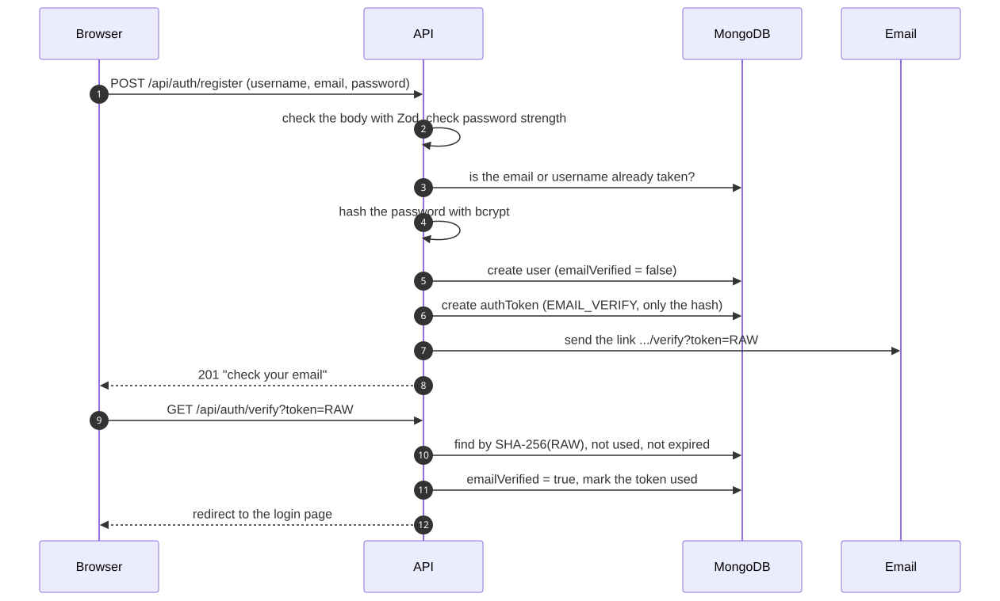
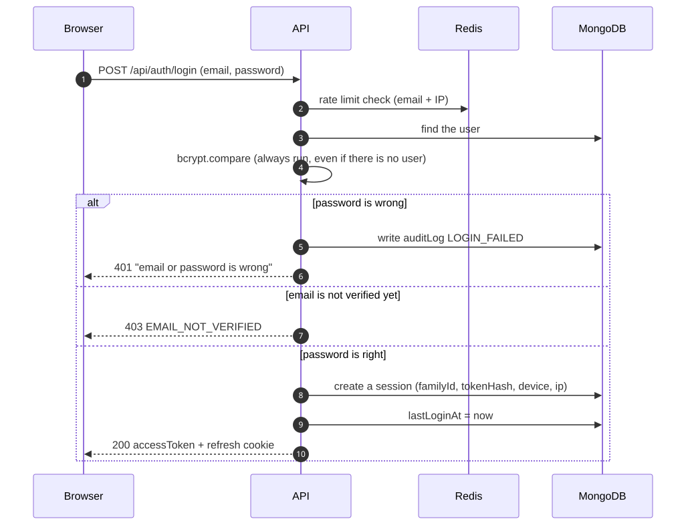
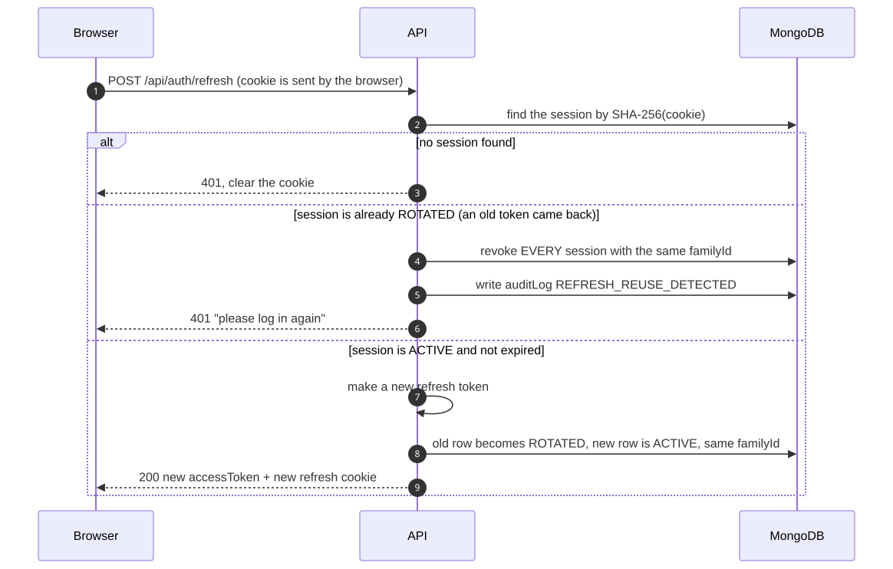

# Code Judge — Authentication and Authorization

Login is **email + password**. Nothing else.

No Google login. No GitHub login. No authenticator app. No codes by email or SMS.

The rest of this document is about doing that one thing properly: how the tokens work, how logout works, and what stops the common attacks.

> Diagram sources live in [diagrams/](diagrams/) as `.mmd` files. The pictures below are rendered from them.

---

## 1. What the login does and does not include

**Included**

- Sign up with email and password
- Verify the email address before you can run code
- Login with email and password
- Forgot password by email link
- Change password
- Logout on this device, or on every **other** device
- Three roles: `USER`, `SETTER`, `ADMIN`

**Not included**

- No two-factor step of any kind
- No social login (Google, GitHub)
- No magic links
- No "remember this device"

Email is still used, but only for two one-way things: the verification link when you sign up, and the reset link when you forget your password. Nothing in the login flow waits for an email.

---

## 2. The tokens

| Piece             | What it is                                                           | Where it is kept                        | How long it lasts                           |
| ----------------- | -------------------------------------------------------------------- | --------------------------------------- | ------------------------------------------- |
| **Access token**  | Signed JWT (HS256) with the user id, role, and `tokenVersion`        | React memory only, never `localStorage` | 10 minutes                                  |
| **Refresh token** | 32 random bytes. Not a JWT.                                          | httpOnly cookie on the path `/api/auth` | 14 days, but replaced every time it is used |
| **Session**       | A row in `sessions` holding the SHA-256 of the current refresh token | MongoDB                                 | Removed by a TTL index when it expires      |
| **Email links**   | Verify email, reset password. Random, saved as a hash.               | MongoDB `authTokens`                    | 24 h / 30 min                               |

### Why not just one long JWT?

| Problem with one long JWT                                           | What we do instead                                                                                 |
| ------------------------------------------------------------------- | -------------------------------------------------------------------------------------------------- |
| You cannot cancel it. Ban a user and their token still works.       | 10-minute access token + a `tokenVersion` number that kills every token at once                    |
| Keeping it in `localStorage` means any injected script can read it. | Access token stays in memory. The refresh token is an httpOnly cookie that JavaScript cannot read. |
| A stolen token works quietly until it expires.                      | The refresh token changes on every use, and using an old one kills the whole login                 |
| "Log out everywhere" is not possible.                               | Sessions are rows in the database and can be deleted                                               |

### What is inside the access token

```json
{
   "sub": "6702a1f4c2a1b3d4e5f60001",
   "role": "USER",
   "tv": 3,
   "sid": "6702c3aa11bb22cc33dd0001",
   "typ": "access",
   "iat": 1789543210,
   "exp": 1789543810,
   "iss": "code-judge",
   "aud": "code-judge-web"
}
```

- `tv` is the user's `tokenVersion`. Every request compares it with the value in the database. If they are different, the token is dead. That is how a ban or a password change takes effect right away. It costs one read per request; a 30 second Redis cache in front of it is the obvious saving once Redis is in the stack.
- `sid` is the session id, so one device can be logged out on its own.
- `typ` stops one kind of token being used in place of another.
- Signed with **HS256** using one secret, `JWT_SECRET`. Anything that needs to read a token needs that same secret, so today only the API does. If a second service ever has to verify tokens on its own, move to RS256 and hand it the public key instead.

---

## 3. Sign up and verify the email



**Password hashing — bcrypt**

```
cost (salt rounds) = 12
```

bcrypt is old, well tested, and the `bcrypt` package installs without trouble. Cost 12 takes about 200–300 ms on a normal machine: slow enough to make guessing expensive, fast enough for a login screen. Measure it on your own server and raise the number if it comes out much faster.

Two bcrypt details to remember:

- bcrypt only reads the **first 72 bytes** of a password. Anything after that is ignored, so set a maximum length of 72 in the Zod rule instead of letting people think a longer password is safer.
- The salt is already inside the hash string (`$2b$12$<salt><hash>`), so there is no separate salt field in the database.

**Password rules:** between 10 and 72 characters. Nothing else — no "must have one capital letter" rule, and no check against a list of common passwords. The 72 is bcrypt's own limit, not a made-up number.

That means `password123` and `1234567890` are both accepted. A common-password check (`zxcvbn` score 3 or more) is the cheapest thing that would stop them, and it is worth adding back before this is open to anyone but you.

**Same answer every time:** register and forgot-password give the same reply whether or not the email exists. Otherwise the endpoint tells an attacker who has an account here.

**Verification link:** a random 32-byte token. Only its SHA-256 hash is saved, so a leaked database cannot be used to verify anyone. It works once and dies after 24 hours.

The link in the email points at the web app (`WEB_URL/verify?token=...`), and that page calls `GET /api/auth/verify`. One base URL then covers both development, where Vite proxies `/api`, and production, where the API sits on another host. It also lets the page show the four outcomes — verified, expired, already used, not valid — instead of dropping the person on a login screen with no explanation.

**Until the email is verified there is no sign in at all.** `POST /api/auth/login` checks the password first and then refuses with `403 EMAIL_NOT_VERIFIED`, before any session row or token is made. So an unverified account never holds an access token and never holds a refresh cookie.

That is stricter than gating the judge alone, and it costs nothing: reading problems needs no token, so someone who has not opened the link yet can still browse the whole problem list while signed out. Nothing they could do with a token is anything they should be doing before the address is confirmed.

---

## 4. Login



Things that matter here:

- If the email does not exist, still run `bcrypt.compare` against a dummy hash. Otherwise the reply time tells the attacker that the account exists.
- The message is the same for a wrong email and a wrong password: _"email or password is wrong"_.
- Not verified yet → `403 EMAIL_NOT_VERIFIED`, with a button to send the mail again. No token and no cookie are sent, so this is a dead end until the link is opened.
- Every successful login writes a `sessions` row with browser, OS, and IP, which is what the device list uses.

**Because there is no second step, the password is the only wall.** One thing carries the weight today: bcrypt, so a stolen database is slow to crack. If you ever want a second step later, an emailed code is the easiest thing to add — it needs one extra collection type and one extra screen, and nothing in this design blocks it.

> **Say this part plainly.** There is no rate limit, no account lockout, and no
> common-password check. A guesser can try `password123` against every address
> they know, as fast as bcrypt will answer — roughly four tries a second per
> connection — and nothing stops them or even slows them down. Failed attempts
> land in `auditLogs` as `LOGIN_FAILED`, which makes the attempt visible
> afterwards but does nothing while it is happening.
>
> Three things would close it, cheapest first: the common-password check
> (section 3), the account lockout, and the rate limits in section 10. The
> first two need no new infrastructure. The third needs Redis, which arrives in
> phase 6.

---

## 5. Refresh with rotation and reuse detection

This is the most interesting part of the design and the best thing to talk about in an interview.



**Why it works.** A refresh token can be used once only. If someone steals the cookie and uses it, the real user's next refresh sends a token that is now marked `ROTATED`, and the whole family is killed at once. Both sides are logged out and the audit log records it. Without rotation, the theft would keep working quietly for two weeks.

**One small race to handle:** two browser tabs can refresh at the same moment, and the second one looks like a replay. Keep `previousTokenHash` on the session and allow that one token for a 10-second grace window from the same IP and browser. Anything older counts as a real replay.

**On the React side:** one axios interceptor. On a `401` it calls `/api/auth/refresh` once, and every other waiting request uses that same call instead of starting its own.

---

## 6. Logout and cancelling access



| Action                          | What happens                                                |
| ------------------------------- | ----------------------------------------------------------- |
| Logout (this device)            | This session becomes `REVOKED`, cookie cleared              |
| Logout everywhere               | Every **other** session `REVOKED`, `tokenVersion` + 1, this device gets a new access token |
| Password change                 | Same, and `passwordUpdatedAt` is set                        |
| Password reset                  | All sessions `REVOKED`, this device included — you sign in again |
| Reuse detected                  | Every session in that family `REVOKED`, audit log written   |
| Ban                             | `status = BANNED`, `tokenVersion` + 1, all sessions revoked |
| Remove one device from the list | Only that session `REVOKED`                                 |

An access token that is already out there keeps working for up to 10 more minutes — unless `tokenVersion` changed, which kills it right away. That is the trade: one cached database read per request in exchange for being able to cancel access instantly.

Small detail on "logout on this device": it kills the refresh token at once, but the access token in that tab stays valid until it expires. React throws it away immediately, so nobody notices. If you want it dead on the server too, bump `tokenVersion` there as well — the price is that your other devices get logged out with it.

**"Sign out everywhere" leaves this device alone.** It is the button you press when
a laptop was stolen, so signing yourself out as well would be the wrong thing.
Every other family is `REVOKED`, and `tokenVersion` goes up so their access tokens
die on the spot rather than lasting another 10 minutes. That kills this device's
token too, so the reply carries a fresh one:

```json
{ "accessToken": "...", "user": { ... }, "signedOutCount": 2 }
```

The session row and the refresh cookie are untouched, so the device list still
shows the original sign-in time rather than pretending you just signed in.

A **password reset** is the opposite and stays that way: every session goes, this
one with it, because a reset is what you do when you are not sure who else is in.

---

## 7. Password change and reset

| Flow                | How it works                                                                                                                                                                                                                            |
| ------------------- | --------------------------------------------------------------------------------------------------------------------------------------------------------------------------------------------------------------------------------------- |
| **Change password** | `POST /api/auth/change-password` with the current password and the new one. The current password must be correct. On success: all sessions revoked, `tokenVersion` + 1, and the current device is logged in again with a fresh session. |
| **Forgot password** | `POST /api/auth/forgot-password` with the email. The reply is always the same. If the account exists, a one-time link (30 minutes, hash saved only) goes out.                                                                           |
| **Reset password**  | `POST /api/auth/reset-password` with the token and the new password. The token dies after one use. All sessions are revoked, `tokenVersion` + 1, and if the email was not verified yet, using the reset link verifies it.               |

Sensitive actions — change password, delete account — always ask for the **current password** in the request body. A stolen access token alone is not enough to do lasting damage.

**What can be edited:** username, display name and bio, through `PATCH /api/auth/me`. A username change is allowed and checked for uniqueness the same way registration is — worth knowing that it changes the person's profile URL, so any link to the old one stops working.

**There is no change-email feature.** The email address you sign up with is the one you keep. It is the login name, the reset address, and the thing the verification link proved, so letting it change means another verify-the-new-address flow, a rollback mail to the old address, and a new way to take over an account. Not worth it here. If someone really needs a different address, they make a new account.

---

## 7a. What runs in a transaction

Mongo runs as a one-member replica set, so transactions are available. Four auth
steps write to more than one place and would leave something broken if only half
of it landed:

| Step | Writes | Half done would mean |
|------|--------|----------------------|
| `register` | the user row, and its verification link | an account nobody can confirm, or a link pointing at nothing |
| `verify` | the link marked used, and `emailVerified` | a spent link on an account still unverified, with no way back |
| `reset-password` | the link, the new hash, `tokenVersion`, every session revoked | a new password with the old sessions still alive, which is a hole |
| `refresh` (`rotateSession`) | the new session row, the old one marked `ROTATED` | two live refresh tokens, or being signed out mid-refresh |

Two rules the code follows inside a transaction, both because MongoDB may run the
body again after a transient error:

- **Nothing the database cannot undo.** The verification email is sent after the
  commit, never inside, or a retry would send it twice. bcrypt runs before the
  transaction opens, so a retry does not pay for it again.
- **`updateOne`, not `save()`.** A document already changed in memory has no
  modified paths left on the second run, so `save()` would quietly write nothing.

---

## 8. Who can do what

| Permission                           | USER |    SETTER    | ADMIN |
| ------------------------------------ | :--: | :----------: | :---: |
| read published problems              |  ✅  |      ✅      |  ✅   |
| submit code                          |  ✅  |      ✅      |  ✅   |
| read own submissions                 |  ✅  |      ✅      |  ✅   |
| create / edit own problems           |  ❌  |      ✅      |  ✅   |
| edit anyone's problem                |  ❌  |      ❌      |  ✅   |
| manage test cases                    |  ❌  | own problems |  ✅   |
| read any submission                  |  ❌  |      ❌      |  ✅   |
| change roles, ban users              |  ❌  |      ❌      |  ✅   |
| create contests                      |  ❌  |      ❌      |  ✅   |

Every row above assumes a verified email, because an unverified account cannot sign in.

Middleware order on a protected route:

```
requestId -> helmet -> cors -> rateLimit -> requireAuth -> requireRole(["SETTER", "ADMIN"]) -> requireOwnership -> validate(zod) -> controller
```

- `requireAuth`: read the `Authorization: Bearer` header, check the HS256 signature, then `typ`, `iss`, `aud`, `exp`, then compare `tv` with the user's `tokenVersion`, and check `status` and `emailVerified` on the user row.
- **There is no `requireVerifiedEmail`.** There was one, mounted per route, and it could never fire: login refuses an unverified account, `emailVerified` is only ever written `true`, and neither `verify` nor `reset-password` hands out a token — so no route could ever be reached by an unverified user. The check now sits inside `requireAuth`, where one rule covers every protected route instead of each route having to remember a second middleware.
- `requireRole` takes the list of roles allowed on that route and nothing else gets through. **The roles do not stack.** A route an `ADMIN` should reach has to name `ADMIN`, even where it also allows `SETTER` — which is why the line above lists both. It is more to type at each route, and it means the rule reads where it is mounted instead of being hidden inside the middleware. A misspelt role throws when the route is mounted, because the alternative is a route that quietly refuses everyone.
- `requireOwnership`: a `SETTER` may only touch problems whose `createdBy` is their own id. Never take that id from the request body.
- React hides buttons by role, but that is only for looks. The server checks again every time.

Because admins have no second step either, give the admin accounts a long unique password, keep the number of admins small, and write every admin action to `auditLogs`.

---

## 9. Cookies and CSRF

```
Set-Cookie: refresh_token=<random>;
  HttpOnly; Secure; SameSite=Strict;
  Path=/api/auth; Max-Age=1209600
```

- `HttpOnly` → JavaScript cannot read it, so an XSS bug cannot steal it directly.
- `SameSite=Strict` and `Path=/api/auth` → another website cannot make the browser send it.
- The access token is **not** a cookie, so normal API calls send no cookie and need no CSRF token at all.
- `/api/auth/refresh` and `/api/auth/logout` are the only cookie routes. They also check the `Origin` header against an allow-list.
- On `http://localhost` the `Secure` flag is dropped, and only there.

---

## 10. Rate limits

> **Not built yet.** The counters below need Redis, which arrives with the
> submission queue in phase 6. There is no account lockout either, so until
> then bcrypt's own cost is the only thing slowing a password guesser down.
> The table stays here as the plan.

All counters live in Redis and expire by themselves.

| Endpoint                         | Limit                  | Counted by    |
| -------------------------------- | ---------------------- | ------------- |
| `POST /auth/login`               | 5 per 15 min           | email + IP    |
| `POST /auth/register`            | 3 per hour             | IP            |
| `POST /auth/resend-verification` | 3 per hour             | email + IP    |
| `POST /auth/forgot-password`     | 3 per hour             | email + IP    |
| `POST /auth/refresh`             | 30 per 15 min          | session id    |
| `POST /submissions`              | 1 per 3 s, 30 per hour | user id       |
| everything else                  | 100 per 15 min         | user id or IP |

Over the limit → `429` with a `Retry-After` header.

Email sending gets its own daily cap per user, so nobody can use your server to spam an inbox.

---

## 11. The worker and the WebSocket

The worker is a program, not a person, so it must never use a user token.

- **Worker → API:** best option is that the worker writes verdicts straight to MongoDB and there is no internal HTTP endpoint at all. If you do need one, sign the body with HMAC-SHA256 and a shared secret, send `X-Signature` and `X-Timestamp`, reject anything older than 5 minutes, and compare with a constant-time compare.
- **WebSocket:** the browser connects and sends its access token as the first message. The server checks it, ties the socket to that user id, and only ever sends that user their own submission events. If the token expires, the server asks for a new one and closes the socket after 30 seconds of silence.

---

## 12. Endpoints

| Method | Path                            | Needs                     | What it does                                   |
| ------ | ------------------------------- | ------------------------- | ---------------------------------------------- |
| POST   | `/api/auth/register`            | —                         | create the account, send the verification mail |
| GET    | `/api/auth/verify`              | verify token              | verify the email address                       |
| POST   | `/api/auth/resend-verification` | —                         | send the mail again (rate limited)             |
| POST   | `/api/auth/login`               | —                         | email + password                               |
| POST   | `/api/auth/refresh`             | cookie                    | rotate and get a new access token              |
| POST   | `/api/auth/logout`              | cookie                    | log out this device                            |
| POST   | `/api/auth/logout-all`          | access                    | log out every other device, returns a new token |
| GET    | `/api/auth/me`                  | access                    | who am I                                       |
| PATCH  | `/api/auth/me`                  | access                    | edit username, display name, bio               |
| GET    | `/api/auth/sessions`            | access                    | device list                                    |
| DELETE | `/api/auth/sessions/:id`        | access                    | remove one device                              |
| POST   | `/api/auth/forgot-password`     | —                         | send the reset mail                            |
| POST   | `/api/auth/reset-password`      | reset token               | set a new password                             |
| POST   | `/api/auth/change-password`     | access + current password | change the password                            |

---

## 13. Environment variables

```
JWT_SECRET=            # HS256 secret, at least 32 characters
JWT_ISSUER=code-judge
JWT_AUDIENCE=code-judge-web
ACCESS_TOKEN_TTL=10m
REFRESH_TOKEN_TTL=14d
BCRYPT_ROUNDS=12
COOKIE_DOMAIN=         # empty on localhost
ALLOWED_ORIGINS=http://localhost:5173
WEB_URL=http://localhost:5173
SMTP_URL=console://
MAIL_FROM=no-reply@code-judge.dev
```

None of these has a default inside the code. If one is missing, the server refuses to start. `COOKIE_DOMAIN` is the one exception: it is allowed to be empty, because on localhost the cookie has no domain.

`WEB_URL` is where the two email links point. `WORKER_HMAC_SECRET` from the earlier draft is gone for now — the worker does not exist until phase 6, and an unused required variable is just something else to get wrong.

Make a secret with:

```
node -e "console.log(require('crypto').randomBytes(48).toString('base64url'))"
```

In development `SMTP_URL=console://` prints the whole email, link and all, to the log instead of sending it. Nodemailer still builds the message, so the development path runs the same code as production. For a real inbox in development use Mailhog (`SMTP_URL=smtp://localhost:1025`). Do not put a real SMTP password in the repo.

---

## 14. What each defence stops

| Attack                          | Defence                                                                                    |
| ------------------------------- | ------------------------------------------------------------------------------------------ |
| Password guessing               | bcrypt cost 12, and nothing else. **No lockout, no rate limit, no common-password check** — see the note in section 4 |
| Someone reads the database      | Only hashes are stored: password, refresh token, reset token                               |
| XSS reading the token           | Access token only in memory, refresh cookie is HttpOnly, CSP header                        |
| CSRF                            | SameSite=Strict, cookie only on `/api/auth`, Origin check, no cookie auth on normal routes |
| Stolen refresh token            | Rotation plus reuse detection kills the whole family                                       |
| Token cannot be cancelled       | `tokenVersion` + session rows + a 10-minute lifetime                                       |
| Finding out who has an account  | Same reply and same timing on register and forgot-password                                 |
| Email spam through your server  | Rate limits on the two mail endpoints and a daily cap per user                             |
| Bot accounts flooding the judge | Code cannot be submitted until the email is verified                                       |
| Admin account taken over        | Few admins, strong passwords, every admin action in the audit log                          |

**Known limits, said plainly:** there is no second factor, so a leaked or guessed password is enough to get in — that is the trade we chose for a simpler build. Guessing one is currently only as hard as bcrypt makes it, because nothing rejects a weak password or limits how many can be tried. A stolen access token works for up to 10 minutes. There is no device fingerprinting and no impossible-travel check.

---

## 15. Build order (this is Phase 1 of the dev plan)

> **Status: built.** Steps 1 to 5 and 7 are done. Step 6 is not: neither rate
> limits nor lockout exist, and rate limits need Redis in phase 6 (section 10).
> The by-hand checks are in [06-phase1-checklist.md](06-phase1-checklist.md).

1. `users`, `sessions`, and `authTokens` collections, bcrypt hashing, register and login that return only an access token. No refresh yet.
2. Add the refresh cookie and rotation. Test that replaying an old token kills the family.
3. Email verification and password reset.
4. `requireAuth` (signature, status, `emailVerified`, `tokenVersion`) and `requireRole`.
5. React: auth context, axios interceptor with one shared refresh, protected routes.
6. Rate limits. (Lockout was dropped from the design — section 4.)
7. Later, if you want: the device list page.

**Test these three by hand before moving on:**

- The access token expires while you are using the app and nothing breaks.
- Replaying an old refresh token logs the real user out too and writes an audit row.
- Changing your password logs out every other device at once.
